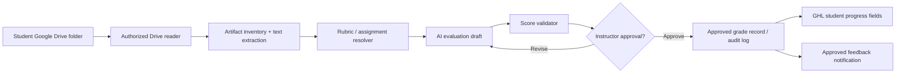

# Architecture — proposed

## Component responsibilities
- **Drive adapter:** OAuth/service account according to workspace policy, read-only folder access, stable file IDs, retrieval, permissions checks, no uncontrolled sharing.
- **Assignment registry:** maps `(track, cohort, week)` to instructor-approved prompt and versioned rubric.
- **Evaluation engine:** evidence-grounded draft; outputs structured JSON and artifact references.
- **Validation layer:** verifies criterion math, IDs, source references and approval state; rejects mismatches.
- **Review queue:** authorized instructor views evidence, edits grade and approves/rejects.
- **GHL adapter:** matches a unique student contact/custom object, upserts minimal approved grade data with idempotency keys; no update if match ambiguous.
- **Notifier:** sends approved student feedback only after confirmed approval and successful authorization.

## Implementation phases
1. Manual Drive folder link + offline rubric grading proof of concept.
2. Read-only Drive integration with secure credentials and artifact manifests.
3. AI model integration with strict JSON schema validation.
4. Instructor review UI/approval and audit log.
5. GHL API integration, deduplication, retries, event notifications.
6. Cohort reporting, permission reviews, monitored deployment.

**Not implemented yet:** all live adapters and review UI. `src/grader.py` validates local reports only.
